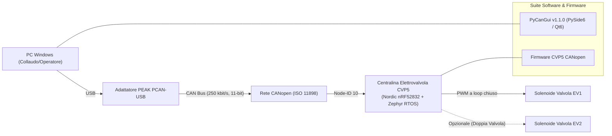

# Galileo Engineering - CVP5 CANopen & PyCanGui

Firmware: Zephyr nRF52
GUI: PyCanGui v1.1.0
CANopen: DS301/DS401
Hardware: CVP5 / GE183B - GE184B

Benvenuti nell'hub di documentazione tecnica ufficiale di **Galileo Engineering** dedicato all'ecosistema di controllo per elettrovalvole proporzionali CAN bus serie **CVP5** e alla suite software desktop **PyCanGui**.

---

## 🚀 Architettura dell'Ecosistema

Il sistema è composto dall'unità di controllo a microcontrollore installata a bordo valvola, dal bus di campo CANopen e dall'applicazione desktop per il collaudo, la diagnostica e la calibrazione:

---

## 📌 Componenti Principali

  

    <h3>⚙️ Centralina Hardware CVP5</h3>
    
Driver proporzionale elettronico per bobine idrauliche (12-30 Vdc, fino a 2.6A). Connettori industriali DIN EN 175301-803 / M12 ad alta protezione ambientale IP65/IP67.

    <a href="#/centralina-hardware" class="btn">Specifiche Hardware &rarr;</a>
  

  

    <h3>⚡ Controllo Digitale & Funzionalità</h3>
    
Algoritmo ad anello chiuso su misura di corrente, correzione linearità a 10 punti, dither a frequenza regolabile e protezioni di sicurezza integrate.

    <a href="#/firmware-nrf52" class="btn">Modalità di Controllo &rarr;</a>
  

  

    <h3>🌐 Protocollo CANopen</h3>
    
Interfaccia standardizzata CANopen DS301/DS401. Mappatura completa RPDO (comandi corrente), TPDO (feedback e allarmi), dizionario SDO completo e servizi LSS per cambio Node-ID.

    <a href="#/canopen-protocol" class="btn">Dettaglio Protocollo &rarr;</a>
  

  

    <h3>🖥️ Software PyCanGui (v1.1.0)</h3>
    
Applicazione grafica desktop moderna in <strong>PySide6 / Qt6</strong> per collaudo, taratura e analisi della risposta dinamica (rise/fall step tests) con adattatori <strong>PEAK PCAN-USB</strong>.

    <a href="#/pycangui-guide" class="btn">Guida PyCanGui &rarr;</a>
  

---

## 📋 Specifiche di Comunicazione Rapide

| Parametro | Valore Predefinito | Note |
| :--- | :--- | :--- |
| **Protocollo Bus** | CANopen (CiA DS301, DS401) | Identificatori CAN a 11-bit |
| **Node-ID di Default** | `10` (decimale, `0x0A` hex) | Configurabile via SDO `0x2106` o LSS |
| **Baud Rate Predefinito** | `250 kbit/s` | Supportati da 10 kBit/s a 1000 kBit/s |
| **RPDO1 (Comando Corrente)** | `0x200 + Node-ID` (`0x20A`) | Bytes 0-1: CH1 UINT16, Bytes 2-3: CH2 UINT16 |
| **TPDO1 (Feedback Analogico)**| `0x180 + Node-ID` (`0x18A`) | Corrente EV1 (mA), Corrente EV2 (mA), Vext, Vsupply |
| **TPDO2 (Stato Allarmi)** | `0x280 + Node-ID` (`0x28A`) | Byte 0: Allarmi EV1, Byte 1: Allarmi EV2 |
| **SDO Server** | Richiesta: `0x600 + Node-ID` Risposta: `0x580 + Node-ID` | Configurazione parametri, guadagni PID e dither |
| **Heartbeat** | `0x700 + Node-ID` (`0x70A`) | Periodo default 1000 ms (SDO `0x1017`) |

---

## 📥 Risorse e Download Immediati

- 📦 **[Scarica PyCanGui Setup v1.1.0](downloads.md#installer-windows-ge_pycan_gui)** - Installer per Windows con driver PEAK integrati.
- 📄 **[Pacchetto Integrazione Distributori](downloads.md#file-dizionario-oggetti-canopen-edsxdd)** - File EDS, XDD, XML per master CANopen (PLC, Codesys, ecc.).
- 📖 **[Manuale Completo Integratori CANopen (HTML)](distributor-manual.html)** - Guida autonoma per sviluppatori di controller custom.
- 📑 **[Datasheet Hardware PDF](downloads.md#datasheet-ufficiali-hardware)** - Specifiche tecniche CVP5-A-H, CVP5-A-M12, CVP5-C-M12.
