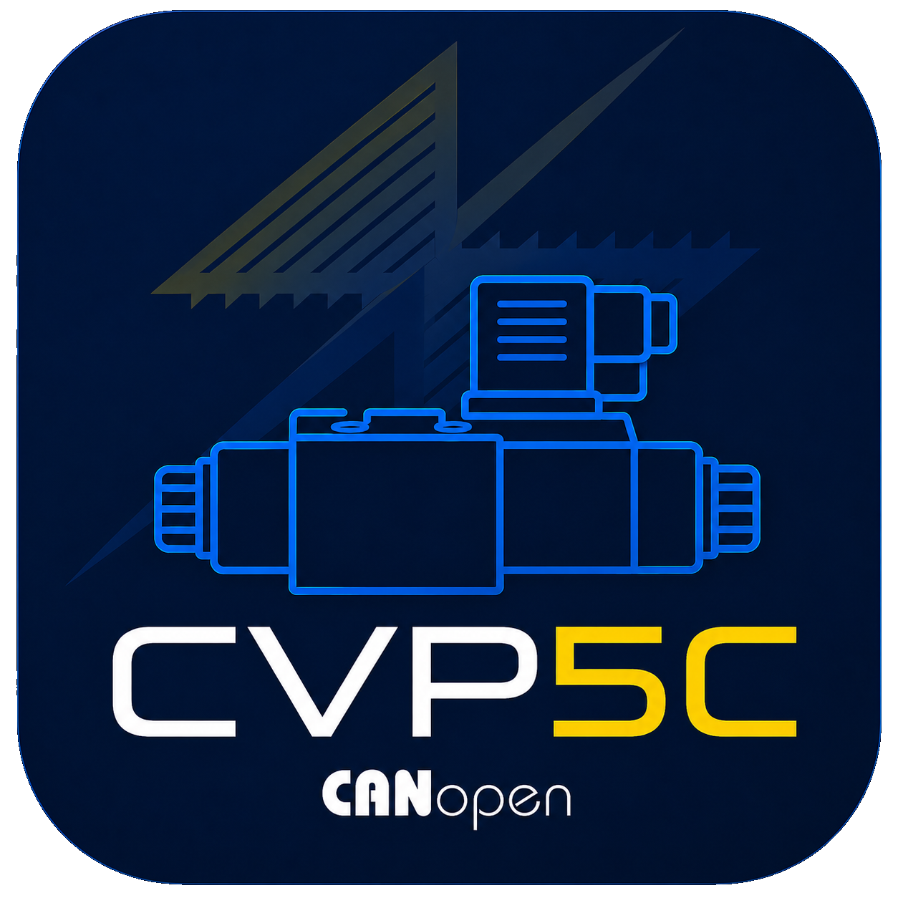

# Galileo Engineering <small>CVP5 CANopen & PyCanGui Documentation Hub</small>

> Documentazione tecnica ufficiale della centralina per elettrovalvole proporzionali CANopen (CVP5) e della suite software di test e diagnostica PyCanGui.

- **Centralina:** Nordic Semiconductor nRF52832 ARM Cortex-M4F + Zephyr RTOS + CANopenNode
- **Protocollo:** CANopen DS301/DS401 (RPDO, TPDO, SDO, Heartbeat, LSS)
- **Suite PC:** PyCanGui v1.1.0 (PySide6 / Qt, PEAK PCAN-USB)
- **Applicazione:** Controllo proporzionale di corrente per valvole idrauliche ed elettrovalvole industriali

  <a class="primary" href="#/README">📘 Documentazione Tecnica</a>
  <a class="secondary" href="#/pycangui-guide">🖥️ Manuale PyCanGui</a>
  <a class="primary" href="#/downloads">📦 Download & Releases (v1.1.0)</a>
  <a class="secondary" href="#/changelog">📋 Changelog & Novità</a>

[GitHub PyCanGui](https://github.com/gbrgnn/GE_PyCAN_GUI)
