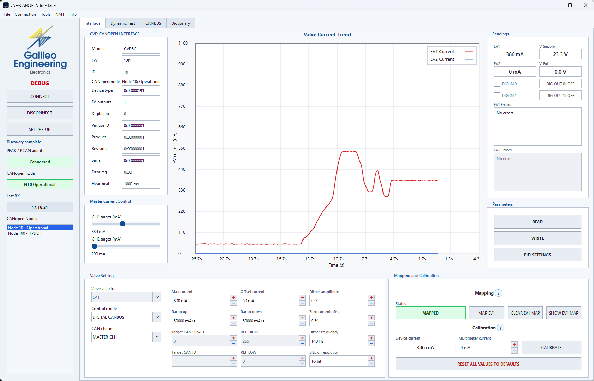
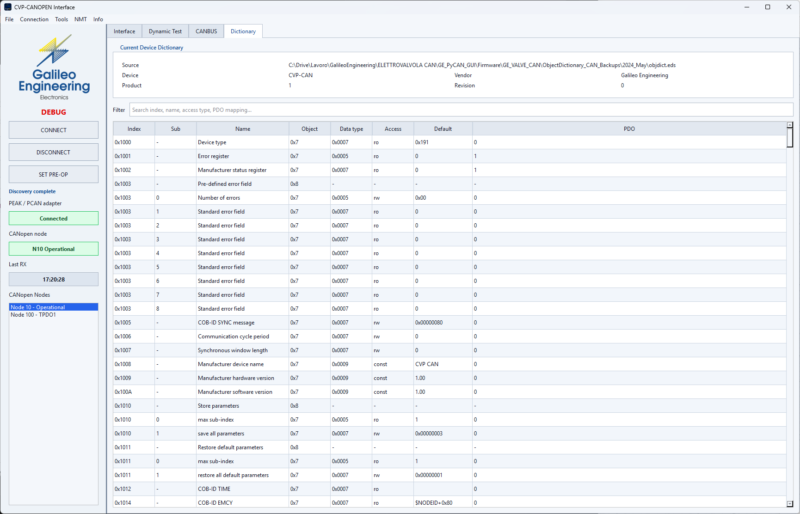
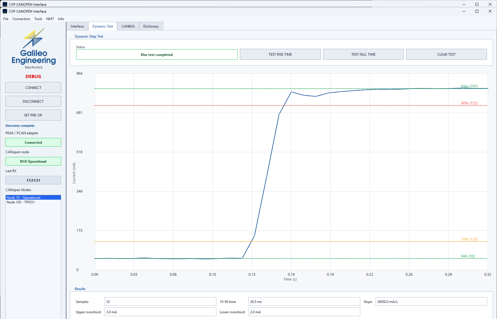
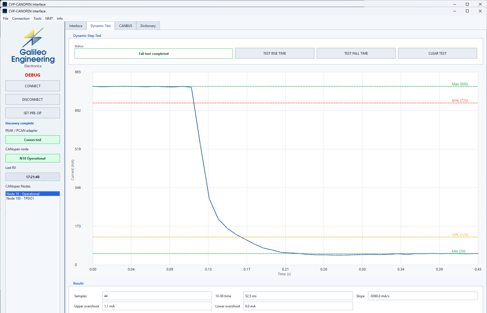
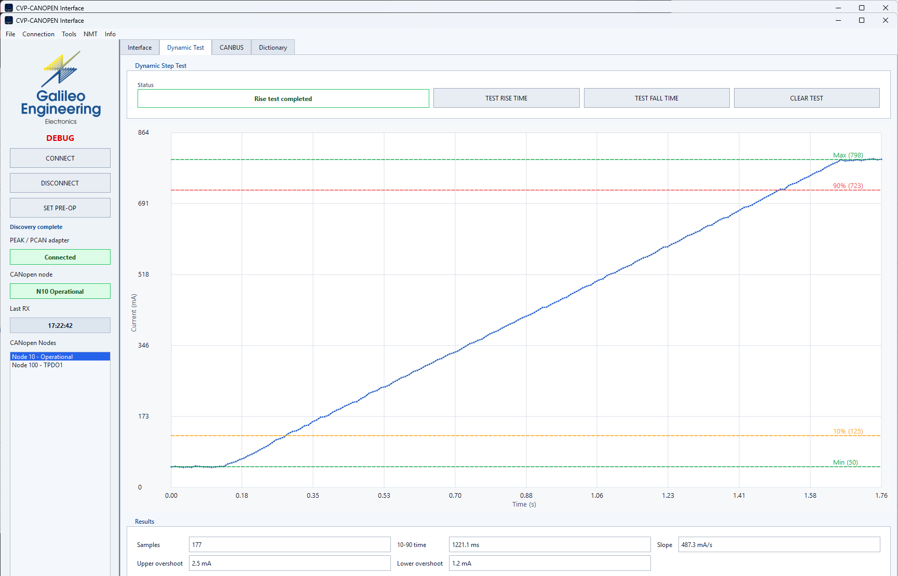
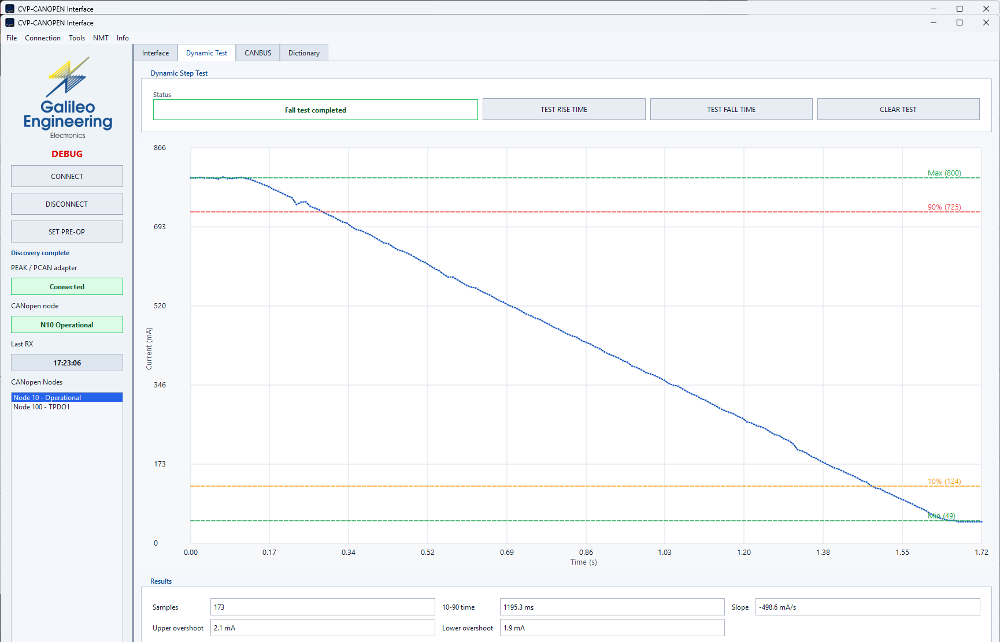
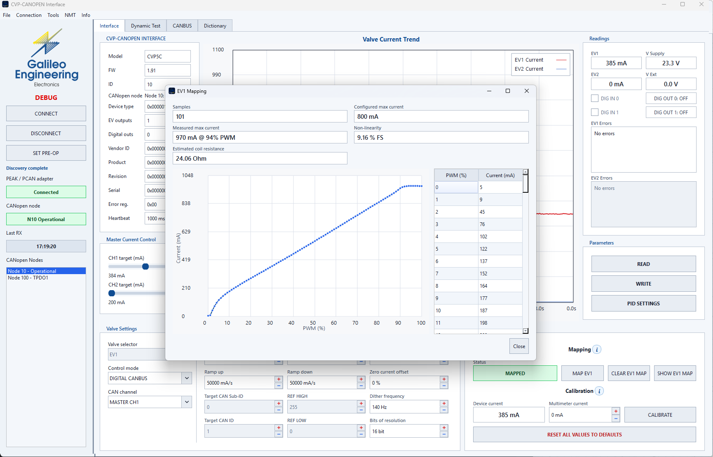
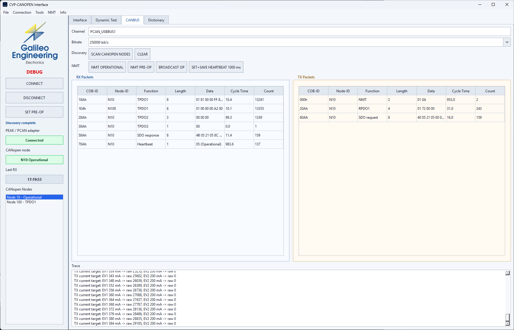

# Manuale Utente PyCanGui (v1.1.0)

<span class="badge badge-green">Versione: v1.1.0</span>
<span class="badge badge-blue">Framework: PySide6 / Qt6</span>
<span class="badge badge-amber">Hardware: PEAK PCAN-USB</span>
<span class="badge badge-blue">Piattaforma: Windows 10/11</span>

**PyCanGui** è l'ambiente software desktop ufficiale di Galileo Engineering per il collaudo, la diagnostica e la calibrazione delle elettrovalvole proporzionali CANopen serie **CVP5**.



---

## 💻 Requisiti di Sistema

- **Sistema Operativo:** Windows 10 / Windows 11 (64-bit).
- **Adattatore CAN:** PEAK System PCAN-USB (o compatibile PCAN-USB Pro/FD).
- **Driver:** PEAK PCAN-Basic API (inclusi ed installati automaticamente con il pacchetto di setup di PyCanGui).
- **Velocità Bus Predefinita:** 250.000 bit/s (250 kbit/s).

---

## 🚀 Avvio del Programma

### Utilizzo con Installer Windows (Consigliato)
Dopo aver completato l'installazione tramite l'eseguibile di setup (`GE_PyCAN_GUI_Setup_v1.1.0.exe`):
1. Collegare l'adattatore PCAN-USB al computer e all'elettrovalvola alimentata.
2. Avviare l'applicazione dal collegamento sul Desktop **GE PyCAN GUI**.
3. Selezionare l'interfaccia (es. `PCAN_USBBUS1`), verificare il Node-ID (default `10`) e cliccare su **Connect**.

### Modalità Simulazione (Senza Hardware)
Per dimostrazioni, test di layout o sviluppo senza valvola collegata, è possibile avviare il software in simulazione:
```powershell
python -m ge_pycan_gui --simulate
```

### Avvio da Terminale con Parametri Custom
```powershell
python -m ge_pycan_gui --channel PCAN_USBBUS1 --bitrate 250000 --node-id 10
```

---

## 🎛️ Funzionalità dell'Interfaccia

### 1. Barra di Connessione & Gestione Stato
- **Pulsante di Connessione Dinamico:** Un unico controllo intuitivo che passa da *Connect* a *Disconnect* con indicazione visiva dello stato.
- **Rilevamento Hot-Unplug (Novità v1.0.0):** Il thread di ricezione RX rileva istantaneamente se l'adattatore USB viene scollegato o se la valvola perde alimentazione, riportando l'interfaccia in stato di sicurezza ed evitando blocchi o crash dell'applicazione.

---

### 2. Monitor Corrente & Regolazione in Tempo Reale
- **Slider Setpoint:** Permette di regolare in tempo reale la corrente desiderata su EV1 (e su EV2, se configurata).
- **Misura Reale (mA):** Visualizza la corrente effettivamente misurata tramite feedback TPDO1.
- **Tensioni di Sistema:** Monitoraggio costante della tensione di alimentazione ($V_{supply}$) e della tensione ausiliaria ($V_{ext}$).
- **Rilevamento Intelligente Mono/Bi-Valvola (Novità v1.1.0):** Se la centralina collegata è a singolo solenoide (CVP5-A o CVP5-C), i controlli del canale EV2 vengono automaticamente disabilitati e contrassegnati con l'indicazione `N.A.`, mantenendo l'interfaccia pulita e priva di allarmi fittizi.

---

### 3. Grafico di Risposta in Tempo Reale (Trend Plot)
Il grafico visualizza l'andamento dinamico della corrente:
- **Traccia Rossa:** Corrente EV1 (mA).
- **Traccia Blu:** Corrente EV2 (mA, visualizzata solo su centraline bi-valvola).
- **Frequenza di Aggiornamento Ottimizzata:** Rendering asincrono fluido senza impegnare la CPU dell'operatore.
- **Fondo Scala Adattivo:** Scala automatica fino alla massima corrente configurata ($I_{max}$).

---

### 4. Browser del Dizionario Oggetti CANopen (SDO)
Permette l'ispezione e la modifica completa di qualsiasi parametro del firmware:



- **Filtro per Categorie (Novità v1.1.0):**
  - *All objects:* Vista completa dell'intero dizionario.
  - *Communication:* Oggetti 0x1000 - 0x1018 (Heartbeat, NMT, Identity, Store).
  - *Manufacturer:* Oggetti 0x2100 - 0x2107 (Guadagni PID, dither, calibrazione correnti).
  - *Device profile:* Parametri standard CiA DS401.
- **Casella di Ricerca Istantanea:** Ricerca per nome dell'oggetto, indice esadecimale o tipologia di accesso (RO/RW).
- **Box Guida CANopen Integrata:** Promemoria visuale dei COB-ID base, posizione dei byte e regole di temporizzazione direttamente nella scheda.
- **Salvataggio Persistente:** Pulsante per il comando di memorizzazione in Flash (`0x1010:1` - `save`).

---

### 5. Test Dinamici di Risposta a Gradino (Rise / Fall Time)
PyCanGui include una suite automatica per verificare la dinamica della valvola e il corretto settaggio delle rampe di accelerazione/decelerazione:

<div class="card-grid">
  <div>
    <h4>Test Salita Rapida (Fast Rise)</h4>
    
  </div>
  <div>
    <h4>Test Discesa Rapida (Fast Fall)</h4>
    
  </div>
</div>

<div class="card-grid">
  <div>
    <h4>Test Salita Dolce con Rampa (Slow Rise)</h4>
    
  </div>
  <div>
    <h4>Test Discesa Dolce con Rampa (Slow Fall)</h4>
    
  </div>
</div>

- **Timeout Dinamico e Adattivo:** Il tempo di attesa del test viene calcolato automaticamente in base alla differenza di corrente impostata e al valore di rampa (mA/s), evitando falsi errori di timeout su transizioni ampie o molto lente.
- **Sicurezza Integrata:** Se durante l'acquisizione si verifica un allarme di protezione valvola (es. sovracorrente o assenza carico), il test viene interrotto all'istante salvaguardando il solenoide.

---

### 6. Mappatura & Linearizzazione Portata
La scheda **Mapping** consente di impostare una curva a 10 punti per correggere le non linearità intrinseche dell'idraulica (zona morta iniziale e saturazione finale):



---

### 7. Monitor Pacchetti Bus CAN
Per attività di collaudo avanzato o supporto all'integrazione su macchine, la schermata **Can Bus Packets** fornisce il monitoraggio completo dei frame in transito:


